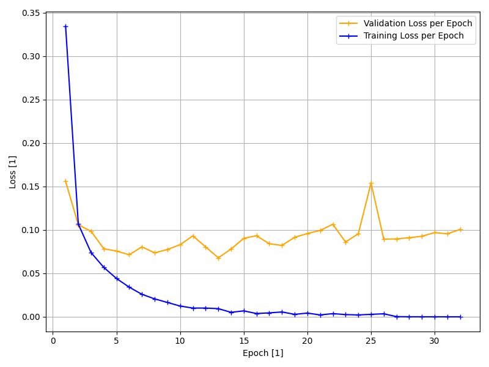

# NumPy CNN for MNIST

A convolutional neural network built from scratch in NumPy to classify MNIST handwritten digits. Every layer, the loss function, and the optimizer are implemented by hand, including their forward and backward passes. No deep learning frameworks are used.

## Features

- Conv2D, ReLU, MaxPool, and Linear layers with manual backpropagation
- Cross-entropy loss computed directly from logits
- Adam optimizer
- Unit tests for the core layers and loss, plus an overfitting sanity test
- Separate scripts for preprocessing, training, and evaluation

## Architecture

| # | Layer      | Configuration                                |
| :- | :-------- | :------------------------------------------- |
| 1 | Conv2D     | 1 → 16 channels, kernel 3×3, "same" padding  |
| 2 | ReLU       |                                              |
| 3 | MaxPool    | 2×2, padded to cover odd sizes               |
| 4 | Conv2D     | 16 → 32 channels, kernel 3×3, "same" padding |
| 5 | ReLU       |                                              |
| 6 | MaxPool    | 2×2, padded to cover odd sizes               |
| 7 | Conv2D     | 32 → 64 channels, kernel 3×3, "same" padding |
| 8 | ReLU       |                                              |
| 9 | Linear     | 3136 → 10                                    |

Input: normalized 28×28 grayscale images. Output: 10 class logits.

**Loss:** Cross-entropy with logits
**Optimizer:** Adam (momentum plus per-parameter adaptive learning rates)

## Results

| Split      | Samples | Usage                                  |
| :--------- | ------: | :------------------------------------- |
| Training   | 29,399  | weight updates                         |
| Validation | 6,300   | monitoring during training             |
| Test       | 6,301   | final evaluation, run once             |

The 42,000 labeled images of the Kaggle dataset were split randomly into train/validation/test (70/15/15). The test set is therefore not the official 10,000-image MNIST test set.

**Test accuracy:** `98.25%` (epochs: `32`, batch size: `32`, learning rate: `3e-4`)



## Getting Started

### Requirements

- Python >= 3.9

```bash
git clone https://github.com/staticl/MNIST
cd MNIST
pip install -e ".[dev]"
```

### Usage

Run the scripts from the project root, in this order:

```bash
python -m scripts.preprocess   # downloads/loads the dataset, saves it to a .npz file
python -m scripts.train        # trains the model, saves weights to a .npz file
python -m main                 # evaluates the trained model on the test set
```

### Running the tests

```bash
pytest
```

## Project Structure

```text
MNIST/
├── data/
│   ├── mnist-dataset/      # raw dataset (not tracked)
│   └── preproccess.py
├── docs/
│   └── loss.png
├── scripts/
│   ├── preprocess.py       # dataset -> .npz
│   └── train.py            # training entry point
├── src/
│   ├── data/               # dataset, dataloader, datamanager
│   ├── nn/                 # layers, loss, model, sequential container
│   ├── optimizer/          # Adam
│   └── train/              # training loop and plotting
├── tests/                  # unit tests for layers, loss, data, overfitting
├── utils/
│   └── math_fn.py
├── pyproject.toml          # project dependencies
├── main.py                 # test-set evaluation
└── README.md
```

## Author

Louis Bösenberg

## Acknowledgments

Dataset: [MNIST as JPG](https://www.kaggle.com/datasets/scolianni/mnistasjpg) by scolianni on Kaggle.